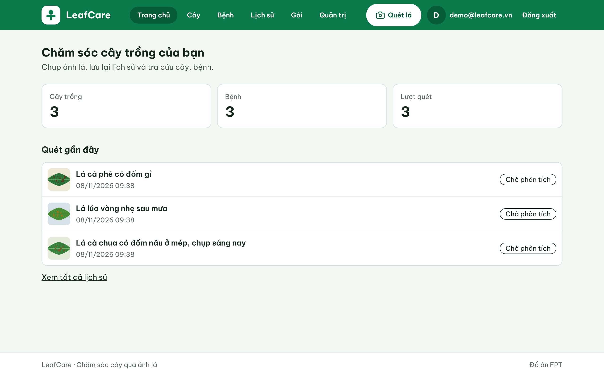
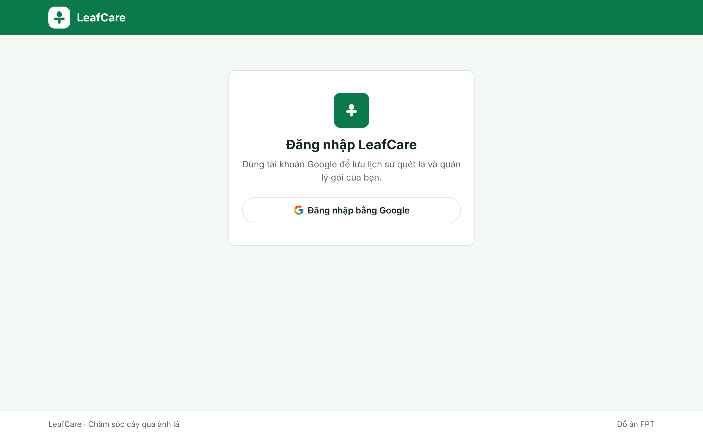
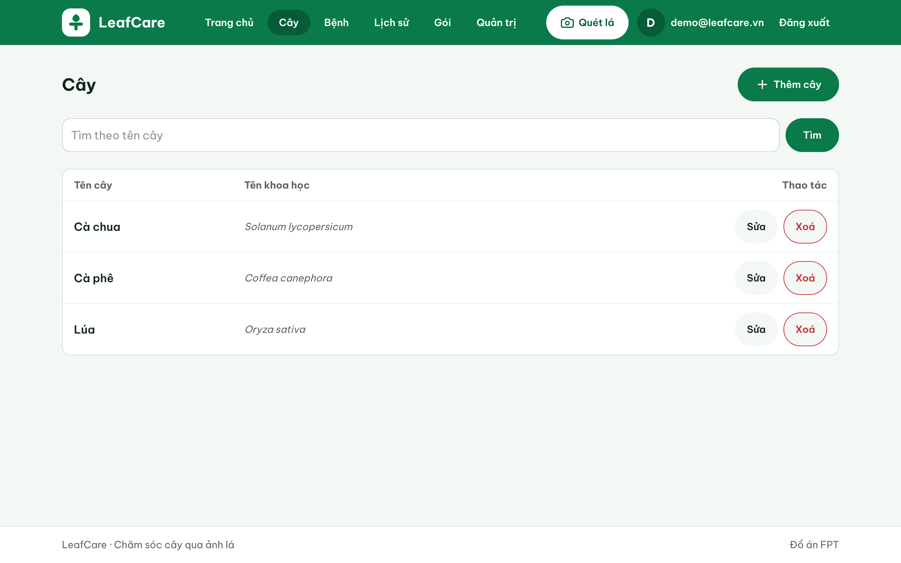
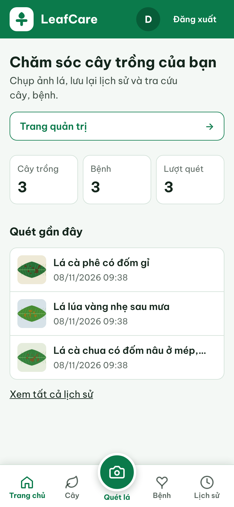
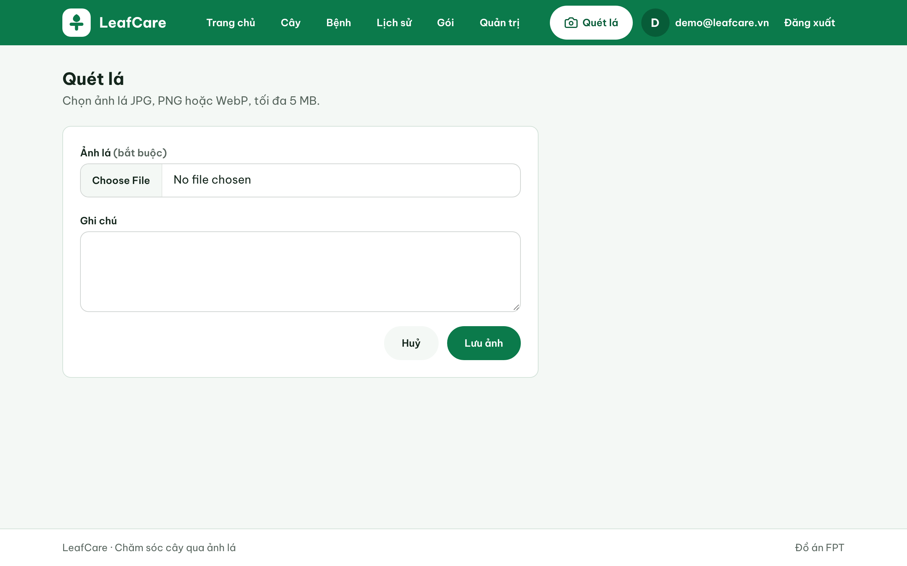
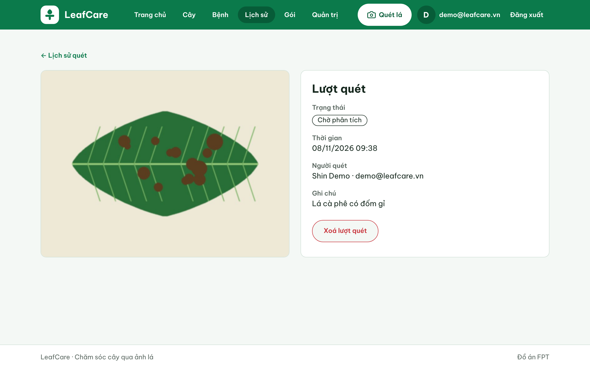
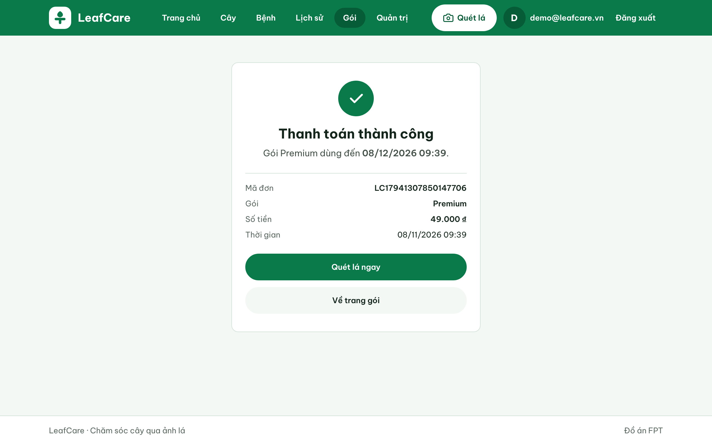
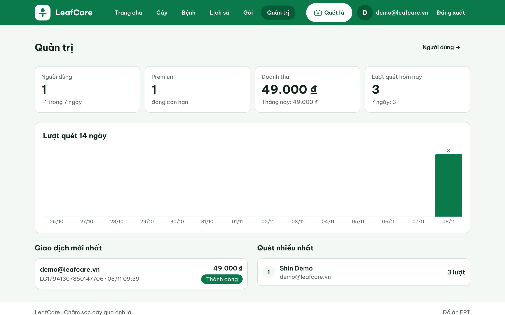

# LeafCare · User Guide (Assignment)

Tài liệu nộp Assignment môn HSF. Gồm 3 phần theo đề:

1. **Setup code**: cài và chạy LeafCare trên máy.
2. **UI toolkit trong Thymeleaf**: dùng Tailwind CSS v4 + DaisyUI v5 với Thymeleaf như thế nào.
3. **AI**: dùng AI nào trong IDE, AI agent nào, cách cài, và cách dùng AI để làm UI và back-end.

App đang chạy thật: https://leafcare-4nh6.onrender.com (đăng nhập bằng Google; gói Free của Render ngủ sau 15 phút, lần đầu mở mất khoảng 1 phút).

Repo: https://github.com/BangSonChau/LeafCare_HSF

---

## 0. LeafCare là gì

Web app quản lý sức khoẻ cây trồng: người dùng chụp ảnh lá, lưu lịch sử quét, tra cứu cây và bệnh, mua gói Premium bằng QR ngân hàng. ADMIN quản lý danh mục và xem dashboard.

| Công nghệ | Dùng cho |
|---|---|
| Java 17, Spring Boot 4.1.2 (MVC, Data JPA, Validation, Security) | Back-end |
| Thymeleaf + thymeleaf-layout-dialect + thymeleaf-extras-springsecurity6 | Render HTML phía server |
| **Tailwind CSS v4 + DaisyUI v5** | UI toolkit (thay cho Bootstrap) |
| PostgreSQL + Flyway | Database, quản lý schema bằng migration |
| Google OAuth2 (OIDC) | Đăng nhập, phân quyền USER / ADMIN |
| SePay + VietQR | Thanh toán Premium bằng chuyển khoản thật |
| JUnit 5 + Mockito + H2 | 190 test, chạy tự động trên GitHub Actions |
| Docker, Render, Neon | Deploy |



---

## 1. Setup code

### 1.1 Cần cài

| Phần mềm | Phiên bản | Ghi chú |
|---|---|---|
| JDK | 17 | IntelliJ IDEA có thể tự tải |
| Node.js | 22 | Chỉ để build CSS (Tailwind CLI) |
| PostgreSQL | 14+ | Hoặc dùng Neon miễn phí |
| Git | bất kỳ | |
| IntelliJ IDEA | bất kỳ | IDE nhóm dùng |

Maven không cần cài: repo có sẵn Maven Wrapper (`mvnw`, `mvnw.cmd`).

### 1.2 Lấy code và tạo database

```bash
git clone https://github.com/BangSonChau/LeafCare_HSF.git
cd LeafCare_HSF
```

Tạo database tên `leafcare` (user `postgres`, cổng 5432):

```sql
CREATE DATABASE leafcare;
```

Không cần tạo bảng. Lần chạy đầu, **Flyway** tự chạy các file `src/main/resources/db/migration/V1__init.sql` … `V6__image_file.sql` và nạp dữ liệu mẫu (`db/seed/V1_1__seed_data.sql`: 3 cây, 3 bệnh).

### 1.3 Biến môi trường

Mọi mật khẩu, khoá đều lấy từ biến môi trường, không ghi vào code. Trong IntelliJ: **Run → Edit Configurations → Environment variables**.

| Biến | Bắt buộc | Ý nghĩa |
|---|---|---|
| `DB_PASSWORD` | Có | Mật khẩu PostgreSQL |
| `GOOGLE_CLIENT_ID`, `GOOGLE_CLIENT_SECRET` | Có, để đăng nhập | OAuth client tạo ở Google Cloud (mục 1.4) |
| `LEAFCARE_ADMIN_EMAILS` | Nên có | Email Google được quyền ADMIN, cách nhau dấu phẩy |
| `SEPAY_BANK`, `SEPAY_ACCOUNT`, `SEPAY_ACCOUNT_NAME`, `SEPAY_API_KEY` | Không | Chỉ cần khi thử thanh toán thật (README, mục SePay) |
| `DB_URL`, `DB_USERNAME` | Không | Đổi DB khác localhost (ví dụ Neon) |

### 1.4 Tạo Google OAuth client (5 phút)

1. Vào https://console.cloud.google.com → tạo project → **Google Auth Platform**.
2. **Branding**: tên app, email. **Audience**: External, thêm email của mình vào **Test users**.
3. **Clients → Create client** → Web application → **Authorized redirect URIs**: `http://localhost:8080/login/oauth2/code/google`.
4. Chép Client ID và Client secret vào hai biến môi trường ở trên.

### 1.5 Build CSS và chạy

```bash
npm ci                 # cài Tailwind CLI + DaisyUI (chỉ lần đầu)
npm run build          # sinh src/main/resources/static/css/output.css
./mvnw spring-boot:run # Windows: mvnw.cmd spring-boot:run
```

Mở http://localhost:8080 → **Đăng nhập bằng Google**.



Khi đang sửa giao diện, mở thêm một terminal chạy `npm run watch` để CSS tự build lại mỗi lần lưu file HTML.

### 1.6 Chạy test

```bash
./mvnw test
```

Test chạy trên H2 trong bộ nhớ, không cần PostgreSQL. GitHub Actions (`.github/workflows/ci.yml`) chạy `npm run build` + `./mvnw verify` cho mọi Pull Request; test đỏ thì không merge được vào `main`.

### 1.7 Cấu trúc code

```
src/main/java/com/son/leafcare/
├── config/        SecurityConfig (Google login, phân quyền)
├── controller/    Plant, Disease, Scan, Plan, Payment, Admin, Home...
├── service/       Nghiệp vụ: PlantService, ScanHistoryService, PaymentService, AdminService...
├── repository/    Spring Data JPA
├── entity/        Plant, Disease, ScanHistory, AppUser, Subscription, Payment, ImageFile
└── exception/     NotFoundException (404), InUseException, ScanLimitException...
src/main/resources/
├── templates/     Thymeleaf: layout/base.html + một thư mục mỗi chức năng
├── db/migration/  Flyway V1..V6
└── static/css/    output.css (sinh từ src/main/css/input.css)
```

Luồng một request: `Controller` nhận form, gọi `Service` (kiểm tra nghiệp vụ, transaction), `Service` gọi `Repository`, `Controller` trả tên template Thymeleaf kèm `Model`.

### 1.8 Deploy (tuỳ chọn)

`Dockerfile` có sẵn. Render build từ nhánh `main`, database dùng Neon (Singapore). Chi tiết từng bước ở `README.md`, mục "Deploy lên Render".

---

## 2. UI toolkit trong Thymeleaf: Tailwind CSS v4 + DaisyUI v5

Đề gợi ý Bootstrap; nhóm dùng **Tailwind CSS v4** (utility class) và **DaisyUI v5** (bộ component như `btn`, `input`, `badge`, `join` viết trên Tailwind). Cách tích hợp với Thymeleaf giống Bootstrap ở chỗ: HTML chỉ cần gắn class, trình duyệt tải một file CSS. Khác ở chỗ: CSS được **build** từ chính các class xuất hiện trong template, nên file nhỏ và không cần JavaScript.

### 2.1 Cài

`package.json`:

```json
"scripts": {
  "build": "tailwindcss -i src/main/css/input.css -o src/main/resources/static/css/output.css --minify",
  "watch": "tailwindcss -i src/main/css/input.css -o src/main/resources/static/css/output.css --watch"
},
"devDependencies": { "@tailwindcss/cli": "^4.3.5", "daisyui": "^5.7.50", "tailwindcss": "^4.3.5" }
```

### 2.2 File cấu hình duy nhất: `src/main/css/input.css`

```css
@import "tailwindcss" source(none);
@source "../resources/templates/**/*.html";   /* quét class trong mọi template Thymeleaf */
@plugin "daisyui" { themes: leafcare --default; }

@plugin "daisyui/theme" {                     /* theme riêng "Phòng khám cây" */
  name: "leafcare";
  --color-primary: #0b7a4b;
  --color-base-200: #f4f8f5;
  --color-error: #c8323a;
  --radius-field: 0.75rem;
  /* ... */
}
@theme { --font-sans: "Be Vietnam Pro", system-ui, sans-serif; }
```

Tailwind v4 không còn `tailwind.config.js`: mọi cấu hình nằm trong CSS. Dòng `@source` là chỗ nối với Thymeleaf: Tailwind đọc các file `.html` trong `templates/`, thấy class nào thì sinh CSS cho class đó. Vì vậy **thêm class mới vào template thì phải chạy lại `npm run build`** (hoặc để `npm run watch` chạy).

### 2.3 Gắn vào layout chung

`templates/layout/base.html` (dùng `thymeleaf-layout-dialect`):

```html
<html xmlns:th="http://www.thymeleaf.org"
      xmlns:sec="http://www.thymeleaf.org/extras/spring-security"
      xmlns:layout="http://www.ultraq.net.nz/thymeleaf/layout">
<head>
  <title layout:title-pattern="$CONTENT_TITLE · LeafCare">LeafCare</title>
  <link rel="stylesheet" th:href="@{/css/output.css}">
</head>
<body class="min-h-screen flex flex-col bg-base-200 text-base-content font-sans">
  <header class="bg-primary text-primary-content">…menu…</header>
  <main layout:fragment="content"></main>
  <footer>…</footer>
</body>
```

Mỗi trang con chỉ khai báo phần nội dung:

```html
<html layout:decorate="~{layout/base}">
<head><title>Cây</title></head>
<body>
<section layout:fragment="content">
  <h1 class="text-2xl font-bold">Cây</h1>
  <a sec:authorize="hasRole('ADMIN')" th:href="@{/plants/new}"
     class="btn btn-primary h-12 rounded-full px-6">Thêm cây</a>
</section>
</body>
</html>
```

### 2.4 Kết hợp class với thuộc tính Thymeleaf

| Cần | Cách viết |
|---|---|
| Đánh dấu menu đang mở | `th:classappend="${#strings.startsWith(currentPath, '/plants')} ? 'bg-secondary'"` |
| Trang hiện tại trong phân trang | `th:classappend="${i == page.number} ? 'btn-primary'"` |
| Nút bị khoá | `th:classappend="${page.first} ? 'btn-disabled'"` |
| Badge trạng thái theo enum | `class="badge"` + `th:classappend` theo `SUCCESS/PENDING/FAILED` |
| Chỉ ADMIN thấy | `sec:authorize="hasRole('ADMIN')"` |
| Lỗi validate dưới ô nhập | `th:errors="*{name}"` trong `<p class="text-error text-sm">` |

Lưu ý: Tailwind chỉ "thấy" class viết nguyên chữ trong file. Viết `'btn-' + ${màu}` thì class không được sinh; phải ghi đủ tên class (`'btn-primary'`).

### 2.5 Component dùng lại (fragment)

`templates/fragments/pagination.html` là thanh phân trang viết bằng DaisyUI `join` + `btn`, dùng chung cho cây, bệnh, lịch sử quét, giao dịch, người dùng:

```html
<nav th:replace="~{fragments/pagination :: pager(${page}, '/plants', ${q})}"></nav>
```

### 2.6 Responsive

Cùng một template chạy cho điện thoại và máy tính nhờ tiền tố `md:`, `lg:`. Ví dụ bảng cây: điện thoại hiện dạng thẻ xếp dọc, từ `md` trở lên hiện bảng (`class="block md:table"`). Điện thoại có thanh điều hướng dưới với nút **Quét lá** luôn trong tầm ngón cái.

| Máy tính 1280px | Điện thoại 390px |
|---|---|
|  |  |

---

## 3. AI: dùng AI nào và dùng thế nào

### 3.1 Công cụ

| Câu hỏi của đề | Câu trả lời |
|---|---|
| IDE | IntelliJ IDEA (chạy app, debug, xem DB). |
| AI dùng trong IDE / AI agent | **Claude Code** (Anthropic), một AI agent đọc repo, sửa file, chạy lệnh (`./mvnw test`, `npm run build`), tạo nhánh và Pull Request. |
| Cách chạy agent | Claude Code nối với repo GitHub. Một phiên "điều phối" nhận yêu cầu, mỗi task chạy trong một phiên riêng, làm trên nhánh riêng và mở PR. |
| Plugin / skill cho agent | **Superpowers** (quy trình brainstorm → spec → plan → TDD → review) và 6 skill UI cài ở mức project: `impeccable`, `emil-design-eng`, `animate`, `animation-performance`, `break-ui`, `review-animations`. |
| Kiểm soát chất lượng | GitHub Actions chạy toàn bộ test cho mỗi PR; người trong nhóm review và merge. |

### 3.2 Setup AI cho project

**Bước 1. Cài Claude Code** (cần tài khoản Claude Pro/Max hoặc API key):

```bash
npm install -g @anthropic-ai/claude-code
cd LeafCare_HSF
claude
```

Hoặc dùng bản web tại https://claude.ai/code, kết nối GitHub rồi chọn repo. IntelliJ: cài plugin Claude Code trong Marketplace để agent mở file và xem diff ngay trong IDE.

**Bước 2. Viết `CLAUDE.md`**, file "luật" mà agent đọc đầu mỗi phiên. Tạo bằng lệnh `/init` rồi bổ sung. Của LeafCare có:

- Lệnh build, test (`./mvnw test`, chạy 1 test).
- **Testing**: mỗi method public trong `service/` và mỗi endpoint phải có JUnit test, viết test trước (TDD); controller dùng `@WebMvcTest` + `@MockitoBean`; test chạy trên H2.
- **Database**: không sửa migration đã merge, đổi schema thì thêm `V<N>__...sql`.
- **UI**: Thymeleaf + Tailwind v4 + DaisyUI v5, không React, không thêm thư viện JS; dùng skill `impeccable` trước khi viết template, `break-ui` trước khi báo xong.
- **Git**: mỗi task một nhánh `feat/task-<N>-...`, không commit thẳng `main`, mở PR, không tự merge.
- **Progress log**: sau mỗi task cập nhật `docs/PROGRESS.md`.

**Bước 3. `docs/PROGRESS.md`**, "bộ nhớ" giữa các phiên: trạng thái hiện tại, việc tiếp theo, các quyết định quan trọng, nhật ký từng task. `CLAUDE.md` import file này (`@docs/PROGRESS.md`) nên phiên mới không phải đọc lại cả repo.

**Bước 4. Cài plugin và skill**: trong Claude Code gõ `/plugin`, thêm marketplace của Superpowers rồi cài `superpowers`. Các skill UI đặt trong `.claude/skills/<tên-skill>/SKILL.md` của project.

**Bước 5. CI**: `.github/workflows/ci.yml` chạy test cho mọi PR, và bật bảo vệ nhánh `main` (PR phải xanh mới merge). Đây là lưới an toàn khi code do AI viết.

### 3.3 Quy trình dùng AI làm back-end

Nguyên tắc: **người quyết định, AI thực thi, test kiểm chứng.** Mỗi chức năng đi qua 6 bước:

```
1. Brainstorm      → AI hỏi lại yêu cầu, đưa 2–3 phương án, người chọn
2. Spec            → docs/superpowers/specs/...-design.md
3. Plan            → docs/superpowers/plans/...md, chia Task nhỏ, ghi rõ file, interface, test
4. Code (TDD)      → nhánh feat/task-N, viết test đỏ → code → test xanh
5. Pull Request    → CI chạy 190 test; người review
6. Merge + ghi log → cập nhật PROGRESS.md
```

**Ví dụ thật: Task 2, CRUD Cây.** Plan (`docs/superpowers/plans/2026-11-07-phase1-assignment.md`) ghi sẵn cho agent:

- Interface: `PlantService.search(q, page)` (trim `q`, kẹp `page` trong khoảng hợp lệ, 10 dòng/trang), `save` ném `DuplicateNameException` khi trùng tên, `delete` ném `InUseException` khi cây đang được bệnh tham chiếu.
- Test viết trước: tìm `"%"` chỉ khớp "Lan 100%" (không coi là wildcard), ô tên trống thì form báo lỗi, id lạ trả 404, xoá cây đang dùng thì báo lỗi.
- Bước chạy: `./mvnw test -Dtest='PlantRepositoryTest,PlantControllerTest'` → đỏ → code → xanh → cập nhật PROGRESS.md → commit.

Nhờ test chạy trên DB thật (`PlantServiceDbTest`), agent tìm ra một lỗi thật: tìm kiếm không có kết quả ở `page>0` trả về sai trang. Lỗi được sửa trước khi merge.

**Ví dụ thật: đổi cổng thanh toán.** MoMo sandbox từ chối thẻ test. Nhóm hỏi agent các lựa chọn, chọn **SePay** (QR VietQR vào tài khoản thật, webhook báo khi tiền về). Agent viết `PaymentService.handleWebhook` (kiểm API key, tìm mã đơn `LC...` trong nội dung, thiếu tiền giữ PENDING) cùng 21 test, rồi hướng dẫn cấu hình. Thử thật bằng 2.000đ: tài khoản lên Premium.

**Ví dụ thật: sửa lỗi sau deploy.** Ảnh quét trên Render bị mất sau mỗi lần deploy (gói Free xoá đĩa). Agent giải thích nguyên nhân, đưa 2 hướng (lưu DB hoặc Cloudinary), nhóm chọn lưu DB; agent thêm migration `V6__image_file.sql`, viết lại `FileStorageService`, thêm test và chạy thử trên PostgreSQL thật.

Kết quả: **25 Pull Request** đã merge, **190 test** tự động, mỗi PR có mô tả và nhật ký trong `PROGRESS.md`.

### 3.4 Mẫu prompt

Prompt ngắn, nói **muốn gì và vì sao**; phần "làm thế nào" nằm trong `CLAUDE.md` và plan.

| Mục đích | Prompt |
|---|---|
| Lên kế hoạch | "Viết spec và plan cho Giai đoạn 2: đăng nhập Google, phân quyền USER/ADMIN, gói Free/Premium. Hỏi tôi trước các quyết định quan trọng." |
| Làm một task | "Làm Task 2 trong plan Phase 1. Theo TDD, xong thì mở PR." |
| Back-end cụ thể | "Thêm giới hạn 5 lượt quét/ngày cho tài khoản Free, tính theo giờ Việt Nam. Premium và ADMIN không giới hạn." |
| Sửa lỗi | "Ảnh quét trên Render bị mất sau khi deploy lại. Tìm nguyên nhân và đề xuất cách sửa." |
| Review | "Review PR này: logic, bảo mật, edge case, test thiếu." |

### 3.5 Dùng AI làm UI

1. `/impeccable init`: agent hỏi về người dùng và mục tiêu, ghi `PRODUCT.md`.
2. Task 1: agent đề xuất hướng thiết kế, nhóm chọn **"Phòng khám cây"** (xanh lâm sàng `#0B7A4B` trên nền trắng men, font Be Vietnam Pro), agent ghi `DESIGN.md`, rồi viết theme DaisyUI và `layout/base.html`.
3. Mỗi trang mới: agent theo `DESIGN.md`, chỉ dùng class Tailwind/DaisyUI, chạy `npm run build`.
4. Trước khi báo xong: skill `break-ui` thử tên rất dài, danh sách trống, nhiều dòng, ở 390px và 1280px; chụp màn hình kiểm tra không tràn ngang.

### 3.6 Lưu ý khi dùng AI

- Không đưa khoá bí mật cho AI; mọi secret ở biến môi trường.
- Đọc diff trước khi merge; CI xanh chưa chắc đúng nghiệp vụ.
- Việc không làm lại được (tiền thật, xoá dữ liệu, deploy) thì người tự làm hoặc xác nhận.
- AI hay "làm thêm": ghi rõ phạm vi trong plan, mục "Không làm".

---

## 4. Kịch bản demo (khoảng 5 phút)

| # | Thao tác | Nói gì |
|---|---|---|
| 1 | Mở repo GitHub: `CLAUDE.md`, `docs/PROGRESS.md`, tab Pull requests | Setup AI: luật cho agent, bộ nhớ giữa các phiên, 25 PR |
| 2 | Mở một PR (ví dụ Task 10), xem mô tả + CI xanh | Quy trình AI làm back-end: plan → TDD → PR → CI |
| 3 | Terminal: `./mvnw test` | 190 test chạy trên H2 |
| 4 | Mở `input.css` và `layout/base.html` | Tailwind + DaisyUI gắn vào Thymeleaf |
| 5 | Mở app, đăng nhập Google | Kết quả chạy thật |
| 6 | Quét lá: upload ảnh + ghi chú, xem lịch sử | Chức năng chính |
| 7 | Gói → tạo QR (không cần chuyển tiền) | Thanh toán SePay |
| 8 | Đăng nhập ADMIN → `/admin` | Dashboard quản trị |

| Quét lá | Chi tiết lượt quét |
|---|---|
|  |  |

| Thanh toán thành công | Dashboard ADMIN |
|---|---|
|  |  |

---

## 5. Còn phải tự làm trước khi nộp

- [ ] **Chụp màn hình prompt** (timeline yêu cầu): mở lịch sử phiên Claude Code, chụp 3–5 đoạn tiêu biểu (lên plan, làm một task, sửa lỗi ảnh mất, review). Lưu vào `docs/assignment/images/prompts/`.
- [ ] Điền tên thành viên vào slide 1.
- [ ] Mở app trên Render vài phút trước khi demo để nó "thức".
